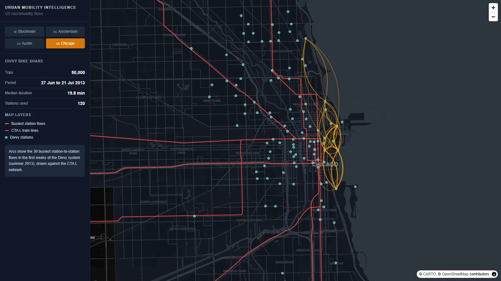
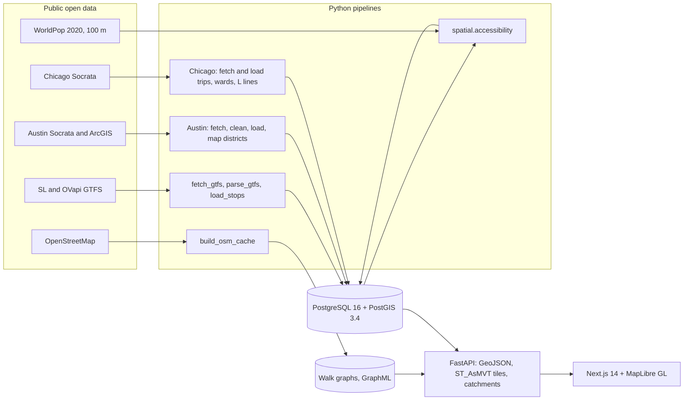

# Urban Mobility Intelligence Platform

[](https://github.com/faryanra/Urban-Mobility-Intelligence-Platform/actions)

A geospatial dashboard that compares two models of urban mobility using public open data:
transit accessibility in **Stockholm and Amsterdam**, and shared micromobility trips in **Austin and Chicago**.
PostGIS does the spatial work, FastAPI serves GeoJSON, vector tiles and network walking catchments, and a Next.js + MapLibre frontend renders it.


| Austin: district to district flows | Chicago: Divvy flows and the CTA L network |
|---|---|
|  |  |

## Findings

All numbers below come from the data loaded by the pipelines in this repository.

- **Stockholm**: mean accessibility score 0.49 across 3,488 cells of 500 m. 18% of cells score below 0.3 and 36% have their centre more than 500 m (straight line) from the nearest of 21,891 SL stops.
- **Amsterdam**: mean score 0.49 across 1,862 cells. 27% of cells score below 0.3 and 50% are more than 500 m from the nearest of 3,215 stops.
- **Austin**: 75% of the 48,200 sampled trips start in Council District 9 (downtown and campus), and 85% start or end there. Use peaks at 22:00 local time.
- **Chicago**: in the first weeks of Divvy (summer 2013), 55% of the 120 active stations lie within 400 m of a CTA L line, and those stations generate 65% of trips.

## Features

- **Accessibility grid**: 500 m square cells scored by transit proximity and population, with a threshold slider that isolates underserved cells.
- **Network walking catchment**: click a stop to see the streets reachable within 500 m of walking, computed with Dijkstra on the OpenStreetMap walk graph rather than a circular buffer.
- **Vector tiles**: all 21,891 Stockholm stops are served as Mapbox Vector Tiles generated by PostGIS `ST_AsMVT`.
- **Flow maps**: the 30 busiest origin-destination pairs drawn as weighted arcs, between council districts in Austin and between stations in Chicago.
- **Hover details**: score components and nearest-stop distance per cell, stop names, trip counts per district, station and corridor.

## Architecture



## Method

### Accessibility score (Stockholm, Amsterdam)

```
cell           500 m x 500 m square built in EPSG:3006 (Stockholm) or EPSG:28992 (Amsterdam)
d              straight-line distance in metres from the cell centre to the nearest GTFS stop
transit_score  max(0, 1 - d / 1500)
density_score  mean WorldPop 2020 population per 100 m pixel inside the cell, divided by the city maximum
score          0.7 x transit_score + 0.3 x density_score
```

Cells are generated and measured in the metric CRS and stored in PostGIS as EPSG:4326 (`accessibility_cells`). The implementation is in [`spatial/accessibility.py`](spatial/accessibility.py).

### Walking catchment

The API loads an OSMnx walk graph per city, finds the nearest node to the clicked stop with a KD-tree, runs Dijkstra with a 500 m cutoff on edge length, and returns the street segments whose two ends are both reachable.

### Austin and Chicago flows

- **Austin** publishes trip origins and destinations by council district, not by coordinate, so arcs connect district centroids. Hours are converted from UTC to Austin local time in SQL.
- **Chicago** trips carry station coordinates. Stations on the map are the 120 stations that appear in the 2013 trip sample.

### Limitations

- The transit score reflects distance to the nearest stop only, not service frequency, hours or mode.
- Stockholm stops cover the whole SL region while the grid covers the city bounding box. Amsterdam stops are clipped to its bounding box.
- Austin uses the first 50,000 rows of the public dataset (9 to 12 Oct 2021 after cleaning). Chicago uses 50,000 trips from 27 Jun to 21 Jul 2013.

## Data sources

| Dataset | Records | Source |
|---|---|---|
| Stockholm transit stops | 21,891 | SL GTFS via Trafiklab |
| Amsterdam transit stops | 3,215 | GTFS NL via OVapi |
| Population 2020, 100 m | Sweden, Netherlands | WorldPop |
| Walk networks | Stockholm, Amsterdam | OpenStreetMap via OSMnx |
| Austin micromobility trips | 48,200 | City of Austin Open Data |
| Austin council districts | 10 | City of Austin ArcGIS |
| Chicago Divvy trips | 50,000 | City of Chicago Open Data |
| Chicago wards | 50 | City of Chicago Open Data |
| CTA L line segments | 153 | City of Chicago Open Data |

Paths, scripts and tables for every dataset are listed in [`docs/data_contracts.md`](docs/data_contracts.md).

## API

| Endpoint | Returns |
|---|---|
| `GET /health` | Database connectivity |
| `GET /api/accessibility?city=` | Accessibility grid as GeoJSON (`stockholm`, `amsterdam`) |
| `GET /api/accessibility/stats?city=` | Cell counts, mean score, cells beyond 500 m |
| `GET /api/tiles/stops/{z}/{x}/{y}.mvt?city=` | Transit stops as vector tiles |
| `GET /api/catchment?city=&lat=&lng=&radius_m=` | Reachable street segments (503 if no walk graph is installed) |
| `GET /api/districts/austin` | Council districts with trip counts |
| `GET /api/od/austin` | Top 30 district to district flows |
| `GET /api/trips/breakdown?city=austin` | Vehicle types, local hourly counts, date range |
| `GET /api/districts/chicago` | Wards |
| `GET /api/metro/chicago` | CTA L line segments |
| `GET /api/stations/chicago` | Stations used in the trip sample |
| `GET /api/od/chicago` | Top 30 station to station flows |
| `GET /api/trips/summary/chicago` | Trip count, median duration, date range |
| `GET /api/trips/summary` | Trip count and mean duration per city in `mobility_trips` |

Static analytical responses are cached in memory for an hour and gzip-compressed.

## Stack

| Layer | Technology |
|---|---|
| Database | PostgreSQL 16, PostGIS 3.4 (Docker) |
| Pipelines | Python 3.11: pandas, GeoPandas, rasterstats, OSMnx, asyncpg, psycopg2 |
| API | FastAPI, asyncpg, NetworkX, SciPy KD-tree |
| Frontend | Next.js 14, TypeScript, MapLibre GL JS 6, Tailwind CSS |
| CI | GitHub Actions: ruff, pytest against a PostGIS service, ESLint, tsc, Next.js build |

## Run locally

Requirements: Docker, Python 3.11+, Node 20+. Run every command from the repository root unless noted.

```bash
# 1. Database (migrations in database/migrations run automatically on first start)
docker compose -f infrastructure/docker/docker-compose.yml up -d

# 2. Python environment
python -m venv .venv
source .venv/bin/activate        # Windows: .venv\Scripts\activate
pip install -r api/requirements.txt -r pipelines/requirements.txt

# 3. European transit, population and accessibility grid
python -m pipelines.fetch_gtfs <TRAFIKLAB_API_KEY>
python -m pipelines.parse_gtfs
python -m pipelines.load_stops
python -m pipelines.fetch_worldpop
python -m spatial.accessibility
python -m pipelines.build_osm_cache          # walk graphs for the catchment feature

# 4. Austin
python -m pipelines.fetch_austin_trips
python -m pipelines.clean_austin
python -m pipelines.load_austin
python -m pipelines.fetch_austin_districts
python -m pipelines.load_austin_districts
python -m pipelines.map_austin_districts

# 5. Chicago
python -m pipelines.fetch_chicago_trips
python -m pipelines.load_chicago_trips
python -m pipelines.fetch_chicago_geo
python -m pipelines.load_chicago_geo

# 6. API on http://localhost:8001
uvicorn api.main:app --port 8001 --reload

# 7. Frontend on http://localhost:3000
cd frontend && npm install && npm run dev
```

Configuration is read from environment variables (see [`api/.env.example`](api/.env.example)):
`DATABASE_URL` (defaults to the Docker database on port 5434), `CORS_ORIGINS`, and `OSM_CACHE_DIR`.
The frontend reads `NEXT_PUBLIC_API_URL` (defaults to `http://localhost:8001`).

If the database volume already existed before a migration was added, apply the new files manually:

```bash
for f in database/migrations/*.sql; do psql "$DATABASE_URL" -f "$f"; done
```

On Windows, Hyper-V can reserve port 5434. If Docker reports the port is unavailable, change the host port in `infrastructure/docker/docker-compose.yml` and in `DATABASE_URL`.

## Deploy

**API (Railway or any container host)**: `railway.toml` starts `uvicorn api.main:app` from the repository root and checks `/health`.
Provision PostgreSQL with PostGIS, apply `database/migrations/*.sql`, then run the pipelines from a local machine with `DATABASE_URL` pointing at the production database.
Set `CORS_ORIGINS` to the frontend URL. The walking catchment needs the GraphML files in `OSM_CACHE_DIR`; without them the endpoint returns 503 and the map shows a notice.

**Frontend (Vercel)**: set the project root to `frontend` and `NEXT_PUBLIC_API_URL` to the API URL. `NEXT_PUBLIC_SITE_URL` sets the absolute URL used in link previews.

## Tests

```bash
pytest tests/ -v                     # needs a migrated database at DATABASE_URL
ruff check api/ pipelines/ spatial/ tests/
cd frontend && npm run lint && npx tsc --noEmit
```

CI runs the same checks on every push to `main`, with the API tests running against a fresh PostGIS container.

## Repository layout

```
api/                      FastAPI application
database/migrations/      SQL schema, applied in order
docs/                     Data contracts and screenshots
frontend/                 Next.js dashboard
infrastructure/docker/    Local PostGIS
pipelines/                Download, clean and load scripts
spatial/                  Accessibility scoring
tests/unit/               API and analysis tests
```
